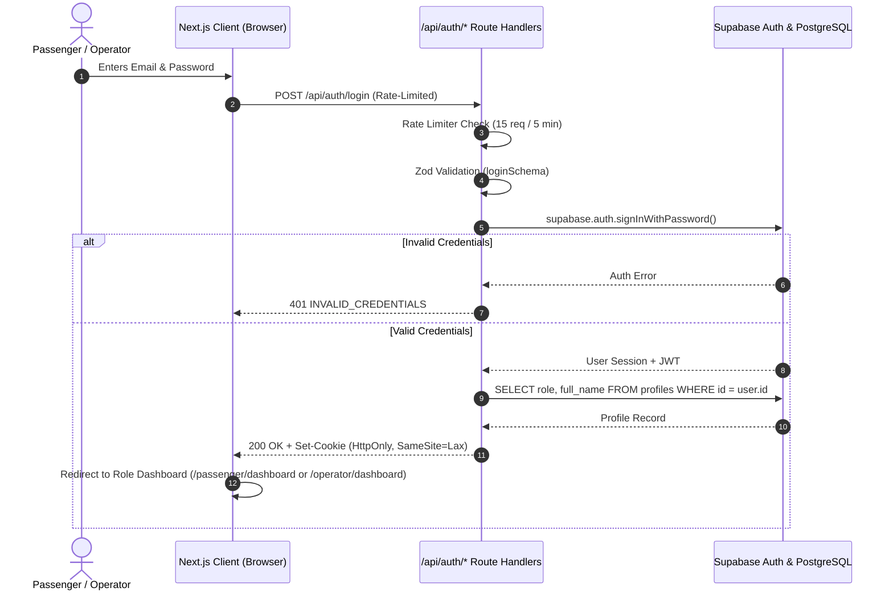

# Authentication & Session Management Architecture

**Document:** `docs/AUTHENTICATION.md`  
**System:** ALGIONS Bus Booking Management System  

---

## 1. Authentication Overview

ALGIONS uses **Supabase Auth** as its core authentication provider, integrating with PostgreSQL `auth.users` and extending user data through `public.profiles`.

### Security Principles:
1. **Zero Client Trust**: User identity, roles, and permissions are determined strictly server-side. Caller-supplied headers (e.g. `x-user-id`) are ignored in production.
2. **HttpOnly Secure Session Cookies**: Session tokens and authenticated user metadata are persisted in `HttpOnly`, `SameSite=Lax`, and `Secure` (production) cookies, preventing XSS-based credential theft.
3. **No Automatic Account Creation on Login**: Login requests strictly require pre-existing registered accounts with verified credentials.
4. **No Role Inference from Email Patterns**: Roles are stored in `public.profiles` and checked against server-side RBAC definitions. User roles are never inferred from email strings.
5. **Least-Privilege Registration**: Public registrations default strictly to `role = 'passenger'`. Operator and Admin roles require explicit administrative assignment.

---

## 2. Authentication Flow



---

## 3. Server-Side Session Extraction (`src/lib/auth/server.ts`)

Every authenticated route handler invokes `requireAuth(req)` or `requireRole(req, allowedRoles)`:

```typescript
export async function getAuthenticatedUser(req: NextRequest): Promise<AuthenticatedUser | null> {
  if (isSupabaseConfigured()) {
    const supabase = await createServerSupabaseClient();
    const { data: { user }, error } = await supabase.auth.getUser();
    if (error || !user) return null;

    const admin = createAdminClient();
    const { data: profile } = await admin
      .from("profiles")
      .select("id, email, role, full_name")
      .eq("id", user.id)
      .single();

    return {
      id: user.id,
      email: user.email!,
      role: (profile?.role as UserRole) || "passenger",
      fullName: profile?.full_name || user.email!.split("@")[0],
    };
  }

  // Fallback to validated HttpOnly session cookie in offline/mock mode
  const sessionCookie = req.cookies.get("algions_user_session");
  if (sessionCookie?.value) {
    const parsed = JSON.parse(sessionCookie.value);
    const profile = db.profiles.get(parsed.id);
    if (profile) return profile;
  }
  return null;
}
```

---

## 4. Role-Based Access Control (RBAC) Matrix

| Endpoint / Operation | Public (Anon) | Passenger | Operator | Administrator |
| :--- | :---: | :---: | :---: | :---: |
| Search Trips (`/api/trips/search`) | Allowed | Allowed | Allowed | Allowed |
| View Seat Maps (`/api/trips/[id]/seats`) | Allowed | Allowed | Allowed | Allowed |
| Public Boarding Verification (`/api/bookings/verify/[pnr]`) | Allowed (Zero-PII) | Allowed | Allowed | Allowed |
| Create Booking (`/api/bookings`) | Denied (401) | Allowed | Allowed | Allowed |
| Cancel Booking (`/api/cancellations`) | Denied (401) | Owner Only | Own Operator Trips | Allowed |
| View Booking by PNR (`/api/bookings/pnr/[pnr]`) | Denied (401) | Owner Only | Own Operator Trips | Allowed |
| Passenger Travel History (`/api/passenger/bookings`) | Denied (401) | Self Only | Self Only | Allowed |
| Operator Dispatch Manifests (`/api/operator/manifests`) | Denied (401) | Denied (403) | Own Operator Trips | Allowed |
| Operator Occupancy & Reports (`/api/operator/reports/*`) | Denied (401) | Denied (403) | Own Operator Data | Allowed |
| Manage Routes, Fleet & Trips (`/api/operator/*`) | Denied (401) | Denied (403) | Own Operator Data | Allowed |

---

## 5. Rate Limiting Protection

Sensitive endpoints enforce a sliding-window rate limit (`src/lib/security/rate-limit.ts`) based on client IP:

- **Login (`/api/auth/login`)**: Max 15 attempts / 5 minutes.
- **Registration (`/api/auth/register`)**: Max 10 attempts / 5 minutes.
- **Public Verification (`/api/bookings/verify/*`)**: Max 60 requests / minute.
- **Booking Creation (`/api/bookings`)**: Max 30 attempts / 5 minutes.
- **Cancellation (`/api/cancellations`)**: Max 20 attempts / 5 minutes.
