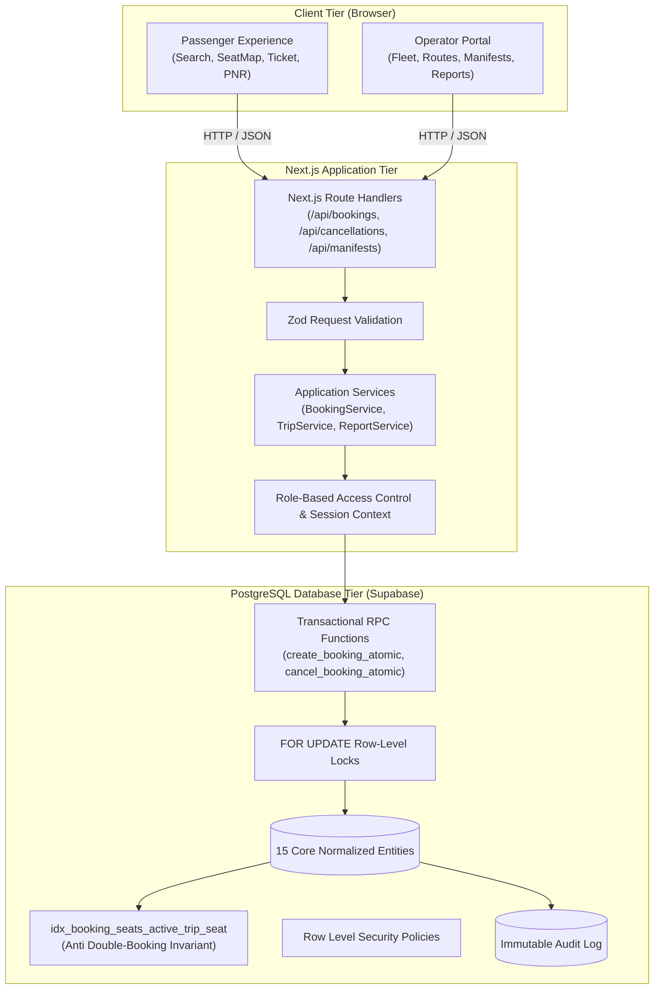

# ALGIONS Bus Booking Management System — Architecture

## 1. High-Level Architectural Pattern
The application is built as a **Modular Monolith** using Next.js 15 (App Router) paired with PostgreSQL hosted on Supabase. This architecture maximizes velocity, strict compile-time type safety, and zero-latency communication between services while guaranteeing multi-user ACID transactions.

---

## 2. Component Responsibilities

### 2.1 Presentation Tier
- **Passenger Interface**: Search for trips, review amenities, choose lower or upper deck berths on interactive SVG/blueprint seat maps, enter passenger manifests, receive authenticated PNR tickets, and cancel bookings.
- **Operator Portal**: Live operations monitoring, schedule new departures, create vehicles and seat layouts, view reconciled passenger boarding manifests, and review occupancy/revenue breakdowns.
- **Shared UI System**: Powered by Tailwind CSS, Radix UI primitives, Lucide React icons, and a custom Transit Blue design system.

### 2.2 Application Service Tier
- **`BookingService`**: Orchestrates client payloads, validates input schema via Zod, attaches idempotency keys, and triggers atomic booking transactions.
- **`CancellationService`**: Validates user ownership or operator dispatcher role, calculates tiered simulated refunds, and releases seat reservations.
- **`TripService`**: Filters trips by origin, destination, and departure date with dynamic seat availability counters.
- **`ManifestService` & `ReportService`**: Compiles passenger lists, calculates load factors, gross ticket sales, refund deductions, and net operator earnings.

### 2.3 Persistence & Transaction Tier
- **Supabase PostgreSQL**: Enforces referential integrity, foreign key cascading, unique constraints, and check constraints.
- **Concurrency & Atomicity**: Row-level locking (`SELECT ... FOR UPDATE`) inside PostgreSQL transactional RPC functions ensures that racing threads cannot double-book a single seat.
- **Storage Invariant**: Partial unique index on active bookings (`booking_seats(trip_seat_id) WHERE is_active = true`) acts as a hard database invariant.

