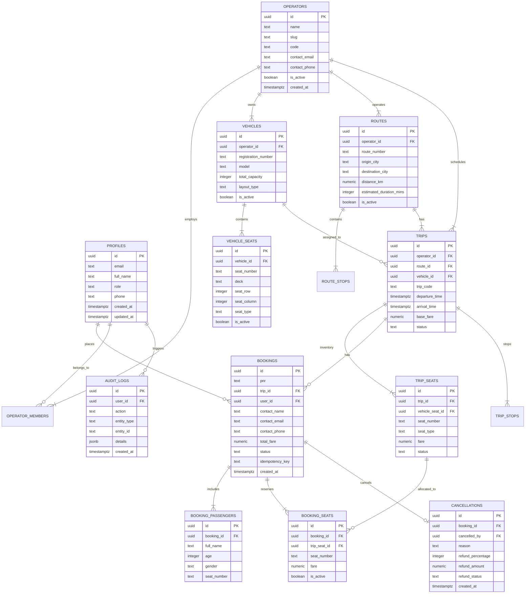

# Database Schema Documentation

## 1. Architectural Invariants
The database schema is designed for PostgreSQL on Supabase, enforcing:
- Strict UUID primary keys.
- Foreign keys with referential integrity (`ON DELETE CASCADE` or `ON DELETE RESTRICT`).
- High-concurrency row locking support via transactional RPC functions.
- Partial unique indexes that guarantee that a single trip seat cannot belong to more than one active booking:
  ```sql
  CREATE UNIQUE INDEX idx_booking_seats_active_trip_seat 
  ON public.booking_seats(trip_seat_id) 
  WHERE (is_active = true);
  ```

---

## 2. Entity-Relationship Diagram (ERD)



---

## 3. Database Functions & Triggers

### 3.1 `create_booking_atomic`
- **Security**: `SECURITY DEFINER`, `SET search_path = pg_catalog, public`
- **Permissions**: `REVOKE ALL FROM PUBLIC, anon; GRANT EXECUTE TO authenticated, service_role;`
- **Parameters**: `p_trip_id UUID, p_user_id UUID, p_seat_ids UUID[], p_passengers JSONB, p_contact JSONB, p_idempotency_key TEXT`
- **Execution Flow**:
  1. Enforces caller identity: verifies `auth.uid() = p_user_id` or caller is admin; blocks anonymous callers with `UNAUTHENTICATED`.
  2. Checks idempotency: if key exists and payload matches, replays previous booking; if payload differs, raises error.
  3. Validates trip status (`scheduled` / `boarding`) and departure time > `now()`.
  4. Validates seat selections (rejects duplicates within request).
  5. **Deterministic Row-Level Lock**: Executes `PERFORM id FROM public.trip_seats WHERE id = ANY(p_seat_ids) AND trip_id = p_trip_id AND status = 'available' ORDER BY id FOR UPDATE` to avoid PostgreSQL aggregate `FOR UPDATE` restrictions and prevent deadlocks.
  6. Calculates count and fare from locked tuples; verifies count matches requested count; throws `SEAT_NOT_AVAILABLE` on conflict.
  7. Generates unique PNR (`ALG-XXXXXX`).
  8. Inserts `bookings`, `booking_passengers`, and `booking_seats` (with `is_active = true`).
  9. Updates `trip_seats` status to `booked`.
  10. Inserts `audit_logs` record.
  11. Returns confirmed booking record.

### 3.2 `cancel_booking_atomic`
- **Security**: `SECURITY DEFINER`, `SET search_path = pg_catalog, public`
- **Permissions**: `REVOKE ALL FROM PUBLIC, anon; GRANT EXECUTE TO authenticated, service_role;`
- **Parameters**: `p_booking_id UUID, p_user_id UUID, p_reason TEXT`
- **Execution Flow**:
  1. Enforces caller identity check.
  2. Acquires row lock on booking record `FOR UPDATE`.
  3. Verifies ownership (passenger owns ticket or user is operator/admin).
  4. Verifies status is `confirmed`.
  5. Calculates hours until departure and applies tiered refund policy (>24h: 90%, 12-24h: 75%, 2-12h: 50%, <2h: 0%).
  6. Updates `booking_seats` setting `is_active = false`.
  7. Updates `trip_seats` setting `status = 'available'`.
  8. Updates `bookings` status to `cancelled`.
  9. Inserts `cancellations` record.
  10. Inserts `audit_logs` record.
  11. Returns cancellation details.

### 3.3 `verify_ticket_by_pnr`
- **Security**: `SECURITY DEFINER`, `SET search_path = pg_catalog, public`, `STABLE`
- **Permissions**: `GRANT EXECUTE TO anon, authenticated, service_role;`
- **Parameters**: `p_pnr TEXT`
- **Execution Flow**:
  1. Queries booking, trip, route, operator, vehicle, and active assigned seat numbers for the given PNR.
  2. Formats sanitized operational boarding metadata (`found`, `pnr`, `status`, `isValidForBoarding`, `originCity`, `destinationCity`, `departureTime`, `arrivalTime`, `operatorName`, `busModel`, `seats`, `isCancelled`).
  3. Omits all passenger PII, contact info, and pricing to protect user privacy during public QR verification.


